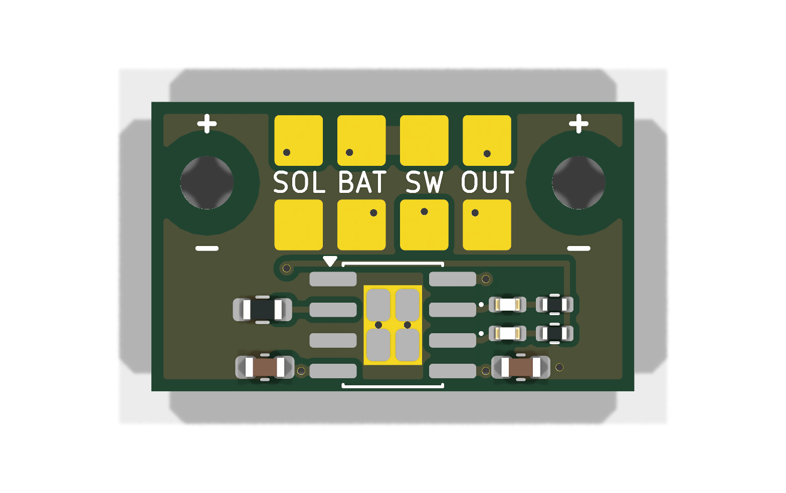
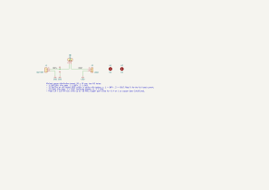
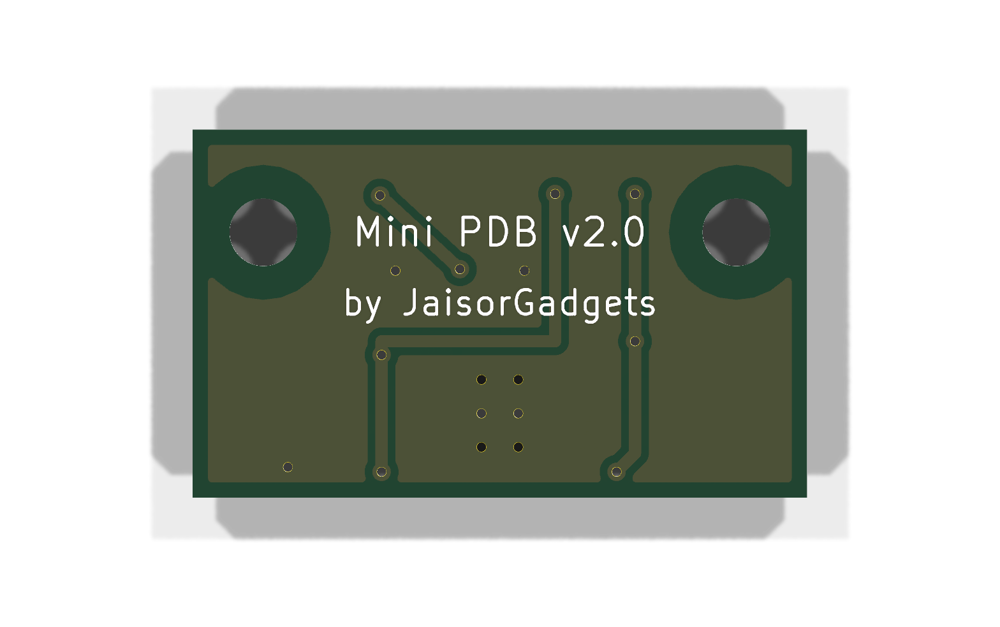

# Mini PDB

Minimal power distribution board with a solar charger. It has solder pads for a 5 V solar panel, a 1S Li-ion battery, a load, and an external switch that breaks the positive wire to the load. A CN3163 charges the battery from the panel at up to 1 A, like the SD05CRMA module, with the same two status LEDs: red while charging, green when the battery is full. 20 × 12 mm, two M2 mounting holes.

| Pads | Top (+) | Bottom (−) |
|---|---|---|
| **SOL** | solar panel + | solar panel − |
| **BAT** | battery + | battery − |
| **SW** | switch, battery side | switch, load side |
| **OUT** | load + (switched) | load − |

The charger feeds the battery directly, so the battery keeps charging with the switch off; the switch only cuts the load. The switch is non-polar, so its two wires can go on either SW pad. All the − pads are connected.

## Specifications

- Board: 20 × 12 mm, 1.6 mm FR-4, 2 layers, square corners (V-score panel friendly)
- Mounting: 2 × M2 (2.2 mm, non-plated), 15.4 mm apart
- Pads: 2.0 × 2.1 mm SMD, for wires up to ~20 AWG
- Current: 1 A maximum on any net
- Solar input: 4.4–6 V. **Absolute maximum 6.5 V**: use a 5 V panel whose open-circuit voltage stays under 6.5 V. No reverse-polarity protection.
- Charging: 4.2 V float, 0.99 A maximum (R1 = 1.2 kΩ). The CN3163 lowers the current by itself when the panel sags toward 4.4 V or the chip reaches ~130 °C. On a board this small it will run hot and throttle at full current, which is normal.
- Status LEDs: red = charging, green = charge complete. Both are powered from the panel, so both are off without sun.
- Parts: CN3163 (eSOP-8), 1.2 kΩ 1 %, 2 × 10 µF 10 V (0603); red and green LEDs, 2 × 1 kΩ (0402). Top side only

## Schematic

## Back

The back is a ground plane with three jumpers (solar input, battery, switched output) and six thermal vias under the CN3163.

## Fabrication

Upload `output/fab/MiniPDB_v2.0_gerbers.zip` (Gerbers incl. solder paste, drill files, job file) to the board house: 2 layers, 1.6 mm, 1 oz copper. The zip isn't tracked in git; regenerate it with the commands in `CLAUDE.md`.

## Regenerating the design

The schematic and board are generated by the scripts in `tools/`; see `CLAUDE.md` for the commands.
